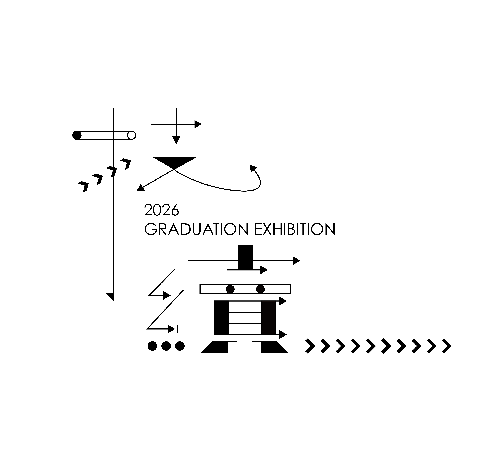
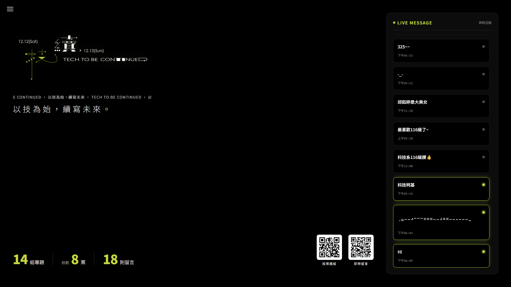
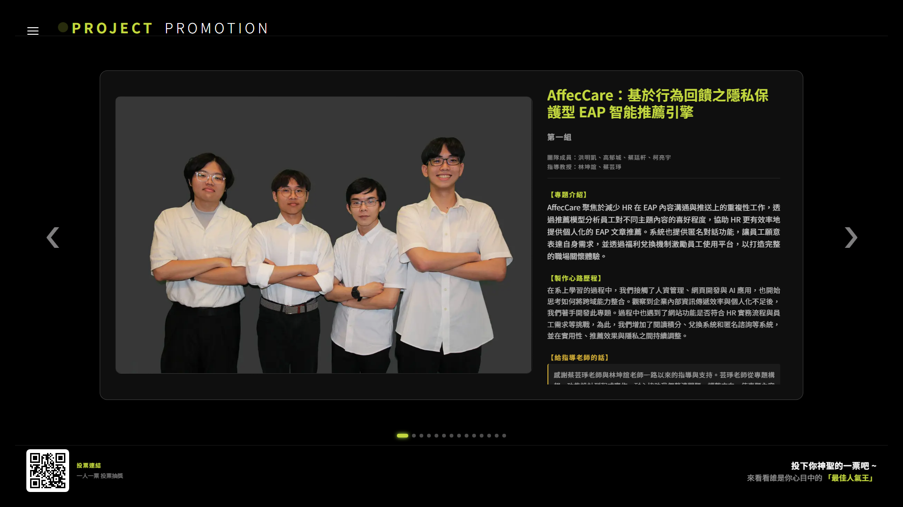
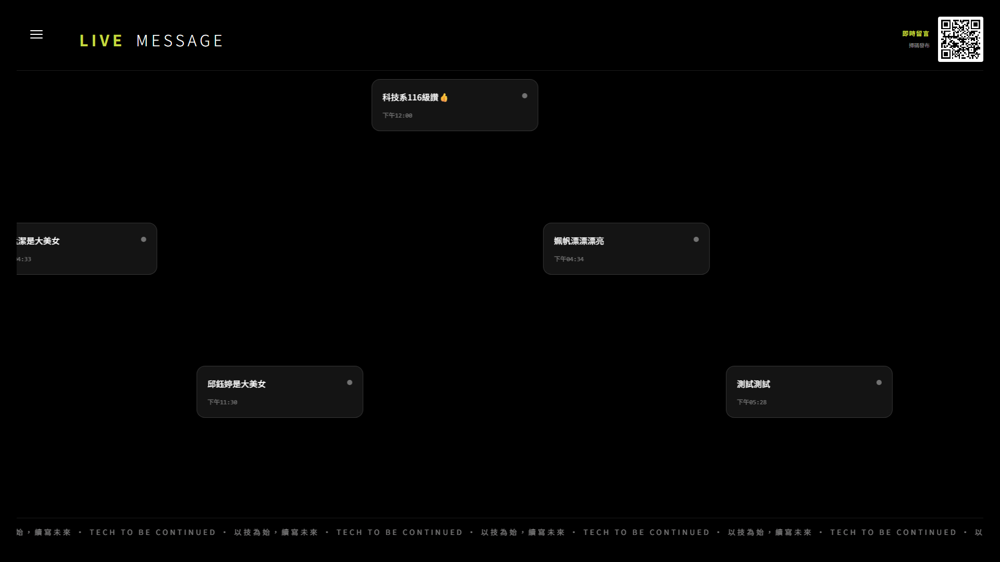
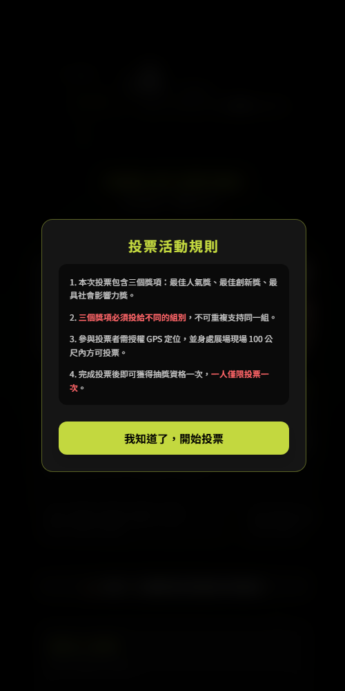
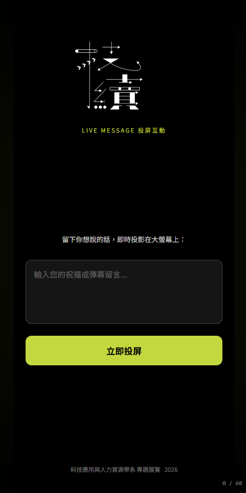
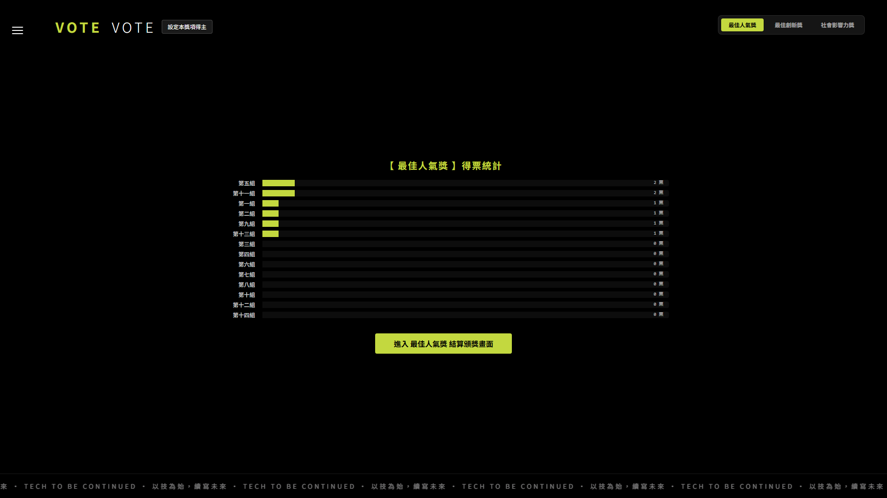
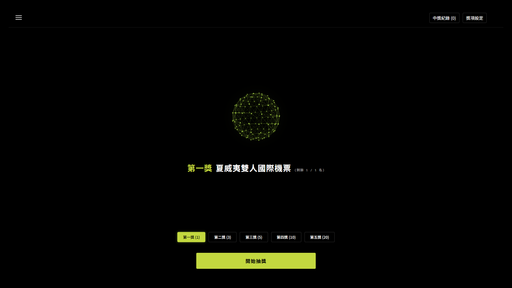

<div align="center">



# 技 ⋅ 續｜Tech to be continued

**Begin with technology, continue into the future.**

The interactive exhibition website for the 2026 Graduation Project Exhibition of the Department of Technology Application and Human Resource Development, National Taiwan Normal University

[🌐 Live Site](https://tech-to-be-continue.vercel.app/) ・ [繁體中文](README.md) ・ **English**

</div>

---

## Overview

*Tech to be continued* is an **on-site interactive system** built for a graduation project exhibition. It serves two kinds of screens at once:

- **The venue's big screen** shows the key visual, introductions of all 14 projects and a live message wall in an automatic rotation. It keeps running through the exhibition without staff attention.
- **Visitors' phones** scan a QR code on the big screen to vote for their favorite projects and post messages that appear on the big screen instantly.

When voting closes, organizers use the same system to tally the awards and run a prize draw. Visitors don't just look at the projects: the whole venue takes part.

### Exhibition Details

| | |
|---|---|
| 📅 Dates | Saturday, December 12 – Sunday, December 13, 2026 |
| 📍 Venue | General Building, National Taiwan Normal University |
| 🏫 Host | Department of Technology Application and Human Resource Development, NTNU |
| 🌐 Website | <https://tech-to-be-continue.vercel.app/> |

---

## Features

### 🖥️ Big-Screen Home: The Exhibition at a Glance

The key visual, a voting countdown, and live counts of projects, votes and messages. The latest messages appear on the right. QR codes for voting and posting messages sit at the bottom.



### 🎞️ Project Showcase: All 14 Projects in Rotation

A new project appears every 5 seconds. Each slide shows the team photo, title, members, advisors, project description, a note on the making process and a message to the advisors. Team photos keep their original 3:2 ratio and are never cropped.



### 💬 Live Message Wall: Visitors' Words on the Big Screen

Messages sent from visitors' phones (up to 60 characters) drift across the big screen as cards. New messages are fetched every 15 seconds.



<table>
<tr>
<td width="50%" valign="top">

### 🗳️ Mobile Voting: Fair and On-Site Only

- Three awards: **Most Popular, Most Innovative and Greatest Social Impact**
- Each award must go to a **different project**
- GPS permission is required, and voters must be **within 100 meters of the venue**
- Phone numbers are checked so each person votes **only once**
- Every voter is automatically entered into the prize draw

</td>
<td width="50%" valign="top">

### 📱 Mobile Messages: Scan and Post

Scan the QR code on the big screen, type a message and tap "立即投屏" (Post to screen). The message shows up on the big-screen message wall.

</td>
</tr>
<tr>
<td></td>
<td></td>
</tr>
</table>

### 🏆 Voting Results and Awards

Vote counts are shown for each award, and one click opens the award ceremony screen. A built-in rule makes sure **no project wins two awards**. If projects tie for Most Popular, the tied runner-up is moved to the Most Innovative award first. Organizers can also choose winners by hand.



### 🎁 Prize Draw

Draws random winners from everyone who voted, with a 3D particle sphere animation and confetti. Prize names and the number of winners per prize are adjustable. Past winners are excluded automatically, and the middle digits of winners' phone numbers are hidden.



### ⚙️ Unattended Mode

The big screen cycles automatically through Home → Message Wall → Project Showcase → Home. Staff can jump to any page or turn off the rotation from the admin menu in the top-left corner.

---

## Exhibited Projects (14)

Project titles and names are listed in the original Chinese.

| Team | Project | Members | Advisor(s) |
|---|---|---|---|
| 1 | AffecCare：基於行為回饋之隱私保護型 EAP 智能推薦引擎 | 洪明凱、高郁城、蔡廷軒、柯亮宇 | 林坤誼、蔡芸琤 |
| 2 | SEL 互動式情緒遊戲盒 | 羅萲、邱妍心、李介文、吳念庭、吳冠志 | 簡佑宏 |
| 3 | 看不見的磨合可視化：探討互動式實體裝置對中高齡職務工作再設計之影響 | 蔡柏元、歐乃逸、潘苡晴、陳生好 | 陳怡靜 |
| 4 | 寶島地標回憶錄 — 透過地標 NFC 連結個人旅行故事 | 羅立茵、蔡詠筑、唐湘婷、張菀宸、廖盈琤 | 簡佑宏 |
| 5 | 音擬而起 OnomaRise | 邱鈺婷、李孟潔、盧姵帆、李佳璇、呂雨璇 | 蔡芸琤、林坤誼 |
| 6 | STEM 學習 ip 設計與推廣 | 楊佳珣、尤騰毅 | 蔡其瑞 |
| 7 | 3D 列印之電動船體設計與製作 | 吳堉安、黃柏彰 | 張玉山 |
| 8 | AI 職員情緒分析與 HR 智慧決策平台 | 陳楷荃、林宸安 | 嚴萬軒 |
| 9 | AI 科技與倫理桌遊：《AI Ethical Thinking Game》 | 林吟貞、周鈺軒、李宛諭、路述恩 | 許庭嘉 |
| 10 | 守把手 — BFRB 行為覺察與壓力調節整合裝置 | 白振廷、林渝桓、王玟晽、陳芷彤 | 林坤誼 |
| 11 | 基於 SLII® 理論之管理模擬桌遊開發與學習成效驗證 | 謝博全、李東璟 | 陳淑媛 |
| 12 | 啟新驅動所 | 林世軒、張語宸、黃宇晟、劉得誼、劉文傑 | 林坤誼 |
| 13 | UNITY × MediaPipe 互動系統整合實作 — 以大湖國小 VR 體驗為例 | 游靜靜、樓冠佑、陳宥均 | 丁玉良 |
| 14 | 數位轉譯角色空間互動系統 | 巫冠儀、周庭伊、廖振廷、劉澤文、康恩瑋 | 林坤誼 |

---

## Pages

| Path | Page | Device |
|---|---|---|
| `/` | Big-screen home | Venue screen |
| `/promo` | Project showcase | Venue screen |
| `/messages` | Live message wall | Venue screen |
| `/vote` | Voting | Visitor's phone |
| `/messages/submit` | Post a message | Visitor's phone |
| `/result` | Voting results and awards | Venue screen (closing ceremony) |
| `/lottery` | Prize draw | Venue screen (closing ceremony) |

---

## Tech Stack

| Area | Technology |
|---|---|
| Framework | [Next.js](https://nextjs.org/) 16 (App Router), React 19, TypeScript |
| Styling | Tailwind CSS 4, Google Fonts (Noto Sans TC, Cactus Classical Serif) |
| Database | MongoDB (via Mongoose) |
| Libraries | `qrcode.react` (QR codes), `canvas-confetti` (confetti effect) |
| Hosting | Vercel |

### Project Structure

```
src/
├── app/
│   ├── page.tsx              # Big-screen home
│   ├── promo/                # Project showcase
│   ├── messages/             # Message wall and mobile message page (submit/)
│   ├── vote/                 # Mobile voting
│   ├── result/               # Voting results and awards
│   ├── lottery/              # Prize draw
│   └── api/
│       ├── vote/             # POST a vote
│       ├── messages/         # GET messages / POST a message
│       ├── stats/            # GET statistics and award results
│       └── lottery/          # GET the draw list (all voters)
├── components/               # Shared components (background, countdown, admin menu)
├── context/                  # Page transition effect
├── data/projects.ts          # Data for the 14 projects
└── lib/                      # MongoDB connection and data models
public/projects/              # Team photos
```

---

## Development and Deployment

### Requirements

- Node.js 20 or later
- A MongoDB database (for example, the free tier of [MongoDB Atlas](https://www.mongodb.com/atlas))

### Run Locally

1. Install dependencies:

   ```bash
   npm install
   ```

2. Create `.env.local` in the project root with your database connection string:

   ```env
   MONGODB_URI=mongodb+srv://<user>:<password>@<cluster-host>/<database>
   ```

3. Start the development server and open <http://localhost:3000>:

   ```bash
   npm run dev
   ```

### Deploy to Vercel

1. Push the project to GitHub and import it on [Vercel](https://vercel.com/new).
2. Add `MONGODB_URI` under **Environment Variables** in the Vercel project settings.
3. Vercel gives you the live URL once the deployment finishes.

### Customization Guide for Future Exhibitions

| What to change | Where |
|---|---|
| Project titles, members, descriptions and photo paths | [`src/data/projects.ts`](src/data/projects.ts) |
| Team photos (3:2 JPG, 2000px wide recommended) | [`public/projects/`](public/projects/) |
| Voting deadline (countdown) | `TARGET_DATE` in [`src/components/Countdown.tsx`](src/components/Countdown.tsx) |
| Venue GPS coordinates and voting radius | `TARGET_LAT`, `TARGET_LNG` and `ALLOWED_RADIUS` in [`src/app/vote/page.tsx`](src/app/vote/page.tsx) |
| Total number of projects (home statistics) | `totalProjects` in [`src/app/api/stats/route.ts`](src/app/api/stats/route.ts) |
| Site title and description | `metadata` in [`src/app/layout.tsx`](src/app/layout.tsx) |
| Logo and key visual | `01_LOGO.png` and other images in [`public/`](public/) |

> 💡 **Tip:** Before each exhibition opens, clear the test votes and messages from the database so they don't affect the statistics or the prize draw.

---

<div align="center">

Department of Technology Application and Human Resource Development, National Taiwan Normal University ・ 2026 Graduation Project Exhibition

</div>
