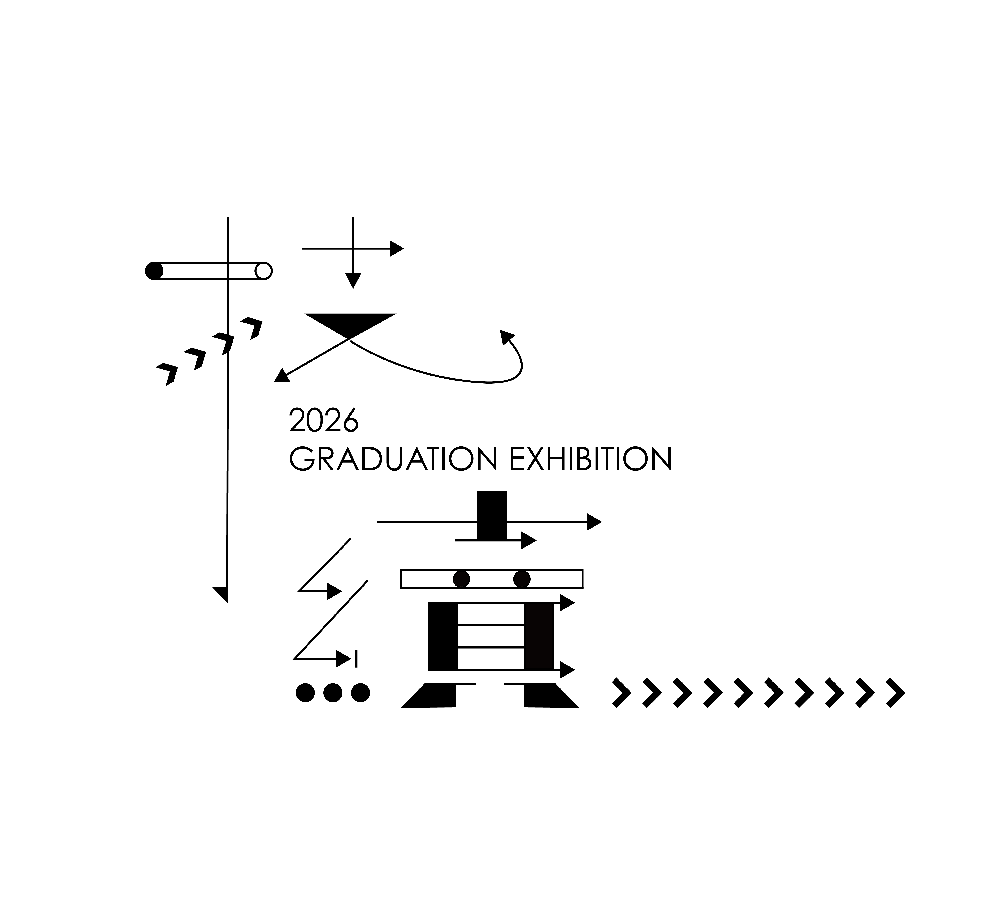
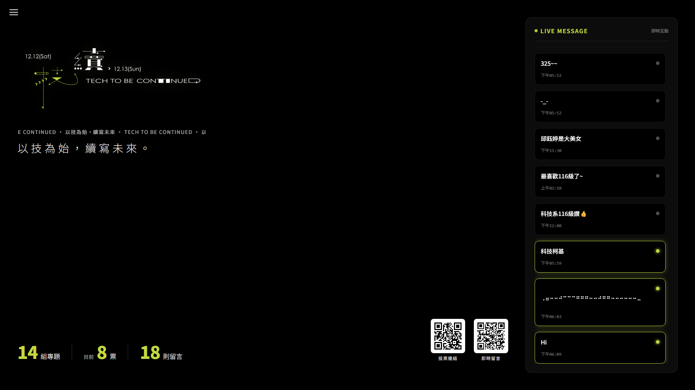
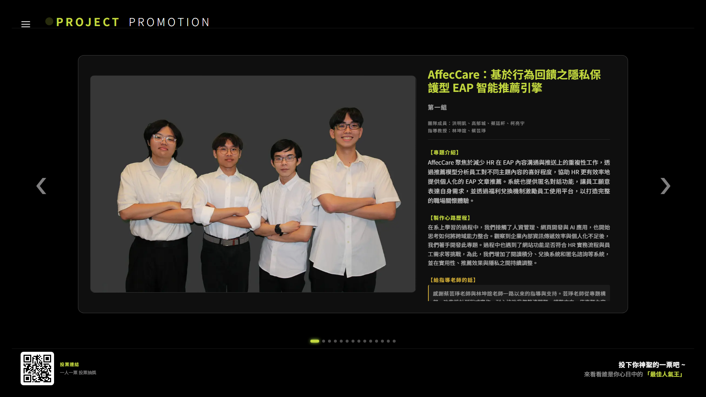
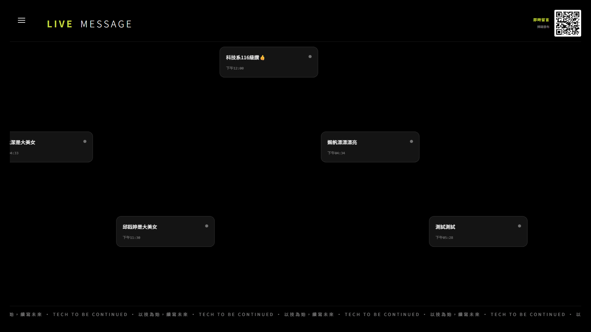
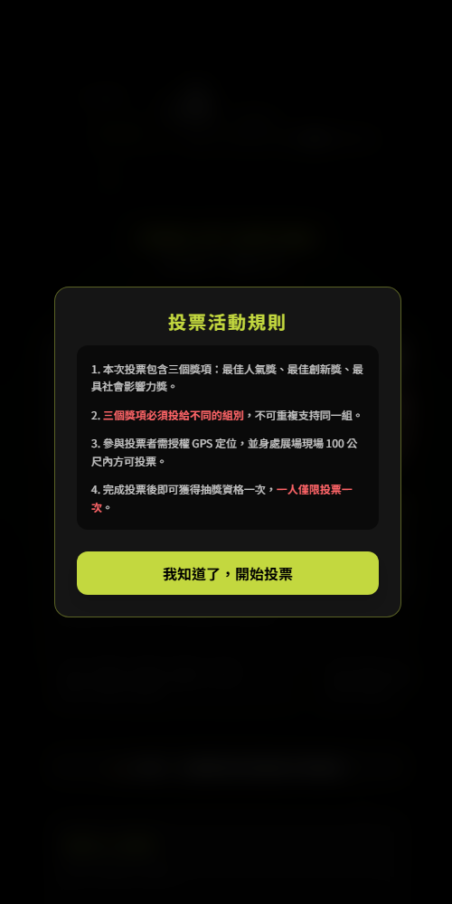
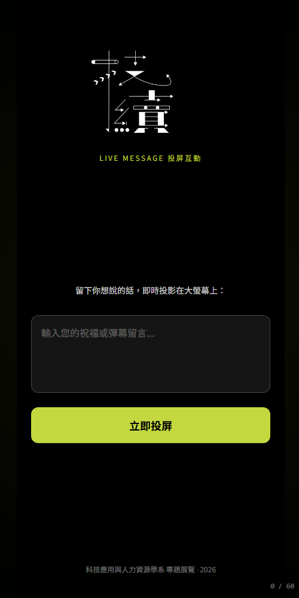
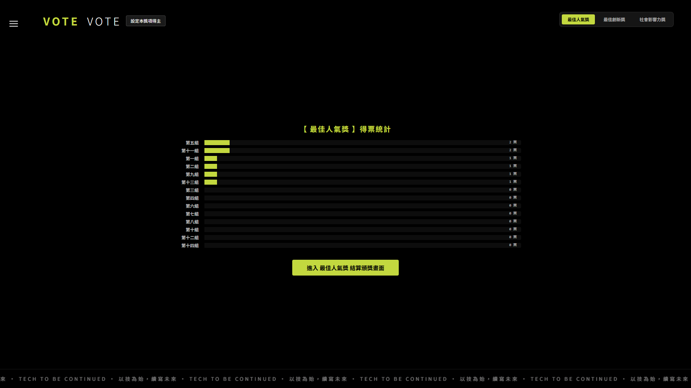
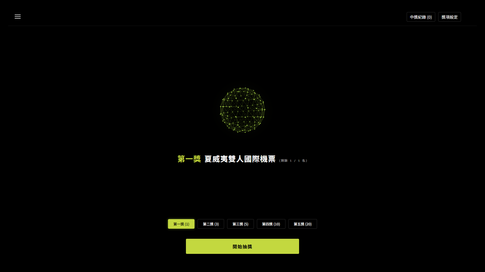

<div align="center">



# 技 ⋅ 續｜Tech to be continued

**以技為始，續寫未來。**

國立臺灣師範大學 科技應用與人力資源學系 2026 畢業專題展 — 展場互動網站

[立即體驗](https://tech-to-be-continue.vercel.app/) ・ **繁體中文** ・ [English](README.en.md)

</div>

---

## 產品簡介

「技・續」是專為畢業專題展打造的**現場互動系統**，同時服務兩種螢幕：

- **展場大螢幕** — 自動輪播主視覺、14 組專題介紹與即時留言牆，展覽期間無人看管也能持續運作。
- **觀眾的手機** — 掃描大螢幕上的 QR Code，就能投票支持喜愛的專題、把留言即時投影到大螢幕上。

投票結束後，主辦方可以直接在同一套系統中統計得獎組別、舉行抽獎，把展覽從「看作品」變成「全場一起參與」的活動。

### 展覽資訊

| 日期 | 2026 年 12 月 12 日（六）～ 12 月 13 日（日） |
|---|---|
| 地點 | 國立臺灣師範大學 綜合大樓 |
| 主辦 | 國立臺灣師範大學 科技應用與人力資源學系 |
| 網站 | <https://tech-to-be-continue.vercel.app/> |

---

## 功能亮點

### 大螢幕主頁：一眼掌握展覽現況

展覽主視覺、投票倒數計時，以及即時更新的「專題數、投票數、留言數」。右側同步顯示最新留言，下方提供投票與留言的 QR Code。



### 專題宣傳輪播：14 組作品輪流登場

每 5 秒自動切換一組專題，展示組照、題目、團隊成員、指導教授、專題介紹、製作心路歷程與給指導老師的話。



### 即時留言牆：觀眾的話飛上大螢幕

觀眾用手機送出的留言（60 字以內），會以彈幕卡片的形式在大螢幕上流動，資料每 15 秒自動更新。



<table>
<tr>
<td width="50%" valign="top">

### 手機投票：公平、限現場

- 設有三個獎項：**最佳人氣獎、最佳創新獎、最具社會影響力獎**
- 三個獎項必須投給**不同的組別**
- 需授權 GPS 定位，並位於**展場 100 公尺內**才能投票
- 以手機號碼驗證，**一人限投一票**
- 完成投票即自動獲得抽獎資格

</td>
<td width="50%" valign="top">

### 手機留言：掃碼即投屏

掃描大螢幕上的 QR Code，輸入想說的話，按下「立即投屏」，留言就會出現在大螢幕留言牆上。

</td>
</tr>
<tr>
<td></td>
<td></td>
</tr>
</table>

### 投票結果與頒獎結算

依獎項顯示各組得票統計，並一鍵進入頒獎畫面。系統內建**不重複得獎**規則：同一組不會同時拿下兩個獎項；若最佳人氣獎出現同票，同票的另一組會優先遞補最佳創新獎。主辦方也可以手動指定得獎組別。



### 現場抽獎

從所有完成投票的觀眾中隨機抽出得獎者，搭配 3D 粒子球動畫與彩帶特效。可自訂各獎項名稱與名額，自動排除已中獎者，並遮蔽得獎者手機號碼中段。



### 展場無人值守模式

大螢幕會依「主頁 → 留言牆 → 專題宣傳 → 主頁」自動輪流切換。工作人員可以從左上角的管理員選單切換頁面，或關閉自動輪播。

---

## 參展專題（共 14 組）

| 組別 | 專題名稱 | 團隊成員 | 指導教授 |
|---|---|---|---|
| 第一組 | AffecCare：基於行為回饋之隱私保護型 EAP 智能推薦引擎 | 洪明凱、高郁城、蔡廷軒、柯亮宇 | 林坤誼、蔡芸琤 |
| 第二組 | SEL 互動式情緒遊戲盒 | 羅萲、邱妍心、李介文、吳念庭、吳冠志 | 簡佑宏 |
| 第三組 | 看不見的磨合可視化：探討互動式實體裝置對中高齡職務工作再設計之影響 | 蔡柏元、歐乃逸、潘苡晴、陳生好 | 陳怡靜 |
| 第四組 | 寶島地標回憶錄 — 透過地標 NFC 連結個人旅行故事 | 羅立茵、蔡詠筑、唐湘婷、張菀宸、廖盈琤 | 簡佑宏 |
| 第五組 | 音擬而起 OnomaRise | 邱鈺婷、李孟潔、盧姵帆、李佳璇、呂雨璇 | 蔡芸琤、林坤誼 |
| 第六組 | STEM 學習 ip 設計與推廣 | 楊佳珣、尤騰毅 | 蔡其瑞 |
| 第七組 | 3D 列印之電動船體設計與製作 | 吳堉安、黃柏彰 | 張玉山 |
| 第八組 | AI 職員情緒分析與 HR 智慧決策平台 | 陳楷荃、林宸安 | 嚴萬軒 |
| 第九組 | AI 科技與倫理桌遊：《AI Ethical Thinking Game》 | 林吟貞、周鈺軒、李宛諭、路述恩 | 許庭嘉 |
| 第十組 | 守把手 — BFRB 行為覺察與壓力調節整合裝置 | 白振廷、林渝桓、王玟晽、陳芷彤 | 林坤誼 |
| 第十一組 | 基於 SLII® 理論之管理模擬桌遊開發與學習成效驗證 | 謝博全、李東璟 | 陳淑媛 |
| 第十二組 | 啟新驅動所 | 林世軒、張語宸、黃宇晟、劉得誼、劉文傑 | 林坤誼 |
| 第十三組 | UNITY × MediaPipe 互動系統整合實作 — 以大湖國小 VR 體驗為例 | 游靜靜、樓冠佑、陳宥均 | 丁玉良 |
| 第十四組 | 數位轉譯角色空間互動系統 | 巫冠儀、周庭伊、廖振廷、劉澤文、康恩瑋 | 林坤誼 |

---

## 頁面一覽

| 路徑 | 頁面 | 使用裝置 |
|---|---|---|
| `/` | 大螢幕主頁 | 展場大螢幕 |
| `/promo` | 專題宣傳輪播 | 展場大螢幕 |
| `/messages` | 即時留言牆 | 展場大螢幕 |
| `/vote` | 投票 | 觀眾手機 |
| `/messages/submit` | 送出留言 | 觀眾手機 |
| `/result` | 投票結果與頒獎結算 | 展場大螢幕（閉幕時使用） |
| `/lottery` | 現場抽獎 | 展場大螢幕（閉幕時使用） |

---

## 技術架構

| 類別 | 使用技術 |
|---|---|
| 框架 | [Next.js](https://nextjs.org/) 16（App Router）、React 19、TypeScript |
| 樣式 | Tailwind CSS 4、Google Fonts（Noto Sans TC、Cactus Classical Serif） |
| 資料庫 | MongoDB（透過 Mongoose 存取） |
| 其他套件 | `qrcode.react`（QR Code）、`canvas-confetti`（彩帶特效） |
| 部署 | Vercel |

### 專案結構

```
src/
├── app/
│   ├── page.tsx              # 大螢幕主頁
│   ├── promo/                # 專題宣傳輪播
│   ├── messages/             # 即時留言牆、手機留言頁 (submit/)
│   ├── vote/                 # 手機投票
│   ├── result/               # 投票結果與頒獎
│   ├── lottery/              # 現場抽獎
│   └── api/
│       ├── vote/             # POST 送出投票
│       ├── messages/         # GET 取得留言 / POST 送出留言
│       ├── stats/            # GET 統計數據與得獎結算
│       └── lottery/          # GET 抽獎名單（已投票者）
├── components/               # 共用元件（背景、倒數、管理員選單）
├── context/                  # 頁面轉場效果
├── data/projects.ts          # 14 組專題資料
└── lib/                      # MongoDB 連線與資料模型
public/projects/              # 各組組照
```

---

## 開發與部署

### 環境需求

- Node.js 20 以上
- 一個 MongoDB 資料庫（例如 [MongoDB Atlas](https://www.mongodb.com/atlas) 免費方案）

### 本機執行

1. 安裝套件：

   ```bash
   npm install
   ```

2. 在專案根目錄建立 `.env.local`，填入資料庫連線字串：

   ```env
   MONGODB_URI=mongodb+srv://<帳號>:<密碼>@<叢集位址>/<資料庫名稱>
   ```

3. 啟動開發伺服器，打開 <http://localhost:3000>：

   ```bash
   npm run dev
   ```

### 部署到 Vercel

1. 將專案推送到 GitHub，並在 [Vercel](https://vercel.com/new) 匯入。
2. 在 Vercel 專案設定的 **Environment Variables** 加入 `MONGODB_URI`。
3. 部署完成後，Vercel 會提供正式網址。

### 給下一屆的修改指南

| 想修改的內容 | 檔案位置 |
|---|---|
| 各組題目、成員、介紹文字、組照路徑 | [`src/data/projects.ts`](src/data/projects.ts) |
| 組照圖片（建議 3:2、寬 2000px 的 JPG） | [`public/projects/`](public/projects/) |
| 投票截止時間（倒數計時） | [`src/components/Countdown.tsx`](src/components/Countdown.tsx) 的 `TARGET_DATE` |
| 展場 GPS 座標與允許投票範圍 | [`src/app/vote/page.tsx`](src/app/vote/page.tsx) 的 `TARGET_LAT`、`TARGET_LNG`、`ALLOWED_RADIUS` |
| 專題總數（主頁統計） | [`src/app/api/stats/route.ts`](src/app/api/stats/route.ts) 的 `totalProjects` |
| 網站標題與描述 | [`src/app/layout.tsx`](src/app/layout.tsx) 的 `metadata` |
| 主視覺 Logo | [`public/`](public/) 中的 `01_LOGO.png` 等圖檔 |

---

<div align="center">

國立臺灣師範大學 科技應用與人力資源學系 ・ 2026 畢業專題展

</div>
